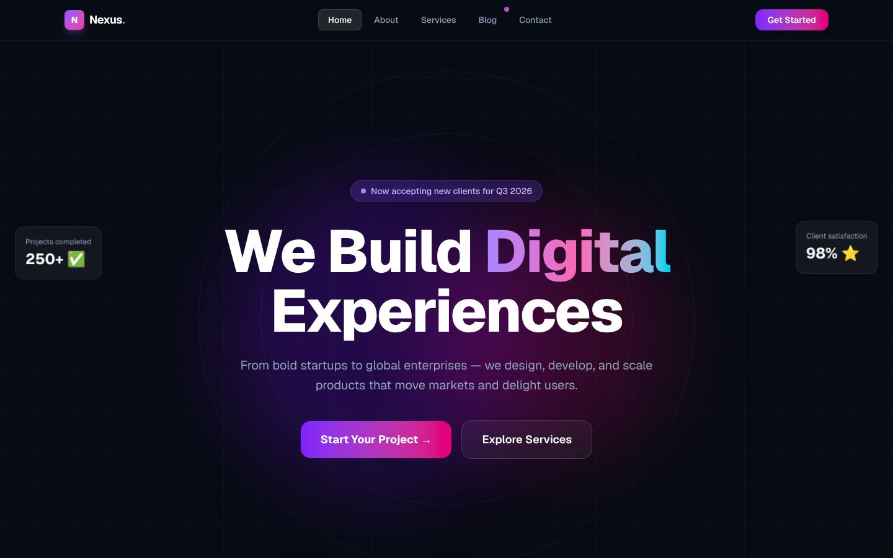
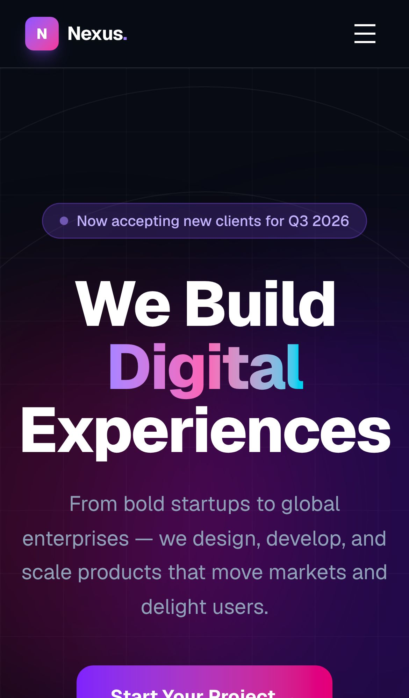
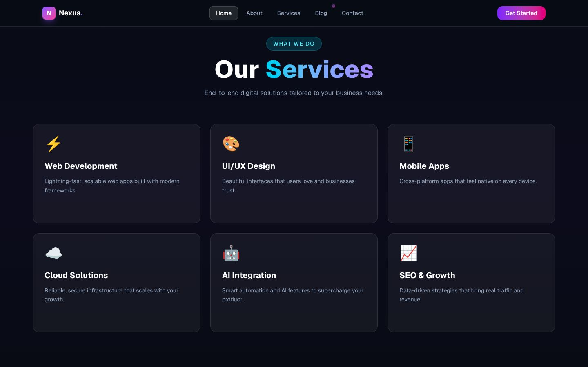

<div align="center">

# Nexus — Next.js + GSAP Agency Site

### A five-page digital-agency website with scroll-driven GSAP animations

Practice project: a dark, animated company-profile site for a fictional digital agency called "Nexus". Built with Next.js 16 (App Router), React 19 and Tailwind CSS 4, with every page animated by GSAP and ScrollTrigger.

[](https://nextjs.org)
[](https://react.dev)
[](https://tailwindcss.com)
[](https://gsap.com)
[](https://developer.mozilla.org/docs/Web/JavaScript)
[](https://react.dev/learn/react-compiler)

**[Portfolio](https://new-portfolio-ashy-xi.vercel.app/)** ·
**[LinkedIn](https://www.linkedin.com/in/eslamraafat-dev/)** ·
**[Email](mailto:eslamraafat736@gmail.com)**

<br>



</div>

<table>
  <tr>
    <td width="33%"></td>
    <td width="67%"></td>
  </tr>
  <tr>
    <td align="center"><sub>Mobile (iPhone 13)</sub></td>
    <td align="center"><sub>Services grid, revealed on scroll with ScrollTrigger</sub></td>
  </tr>
</table>

<sub>Screenshots are from a local production build (<code>npm run build && npm start</code>).</sub>

---

## Contents

- [Overview](#overview)
- [Features](#features)
- [Tech stack](#tech-stack)
- [Pages](#pages)
- [Project structure](#project-structure)
- [Getting started](#getting-started)
- [Deployment](#deployment)
- [Author](#author)

## Overview

I built this site to practise **GSAP inside the Next.js App Router**: running timelines and ScrollTrigger animations in client components, scoping them with `gsap.context()` and cleaning them up when a page unmounts. The agency, its clients, testimonials and numbers are all placeholder content.

## Features

### Animation (GSAP + ScrollTrigger)

- Staggered hero entrance (badge, headline, subtitle, buttons, image) with different easings.
- Sections fade up and cards rise in one after another as they enter the viewport (`scrollTrigger` with `start: "top 85%"`).
- Stat values pop in with a `back.out` ease, and an infinite tech-stack marquee runs with `xPercent`.
- About page timeline line that draws in on scroll.
- Every page wraps its animations in `gsap.context()` inside `useEffect` and calls `revert()` on unmount, so nothing leaks between route changes.
- CSS keyframe "float" animations for the hero's floating cards.

### UI

- Responsive navbar with a mobile hamburger menu and an active-link pill driven by `usePathname()`.
- Home page: hero, tech marquee, stats, services, a five-step process, project showcase, testimonials, tech stack, FAQ and a call to action.
- Services page: services grid, process banner, three pricing plans (one highlighted) and an FAQ accordion.
- Blog page: featured post, category filter buttons, post cards with author rows, an empty state and a newsletter form.
- Contact page: info cards, availability and social links, and a contact form with a loading state and a success message. The form is front-end only: it simulates sending and does not post data anywhere.
- Dark theme with gradient text, glow blobs and a grid background, built entirely with Tailwind utility classes.

## Tech stack

| Layer | Tools |
| --- | --- |
| Framework | Next.js 16.2 (App Router), React 19.2, React Compiler (`reactCompiler: true`) |
| Language | JavaScript (ES modules, `jsconfig.json` path aliases) |
| Styling | Tailwind CSS 4 (`@tailwindcss/postcss`), CSS keyframes |
| Animation | GSAP 3.15 with the ScrollTrigger plugin |
| Fonts | `next/font/google`: Geist, Geist Mono |
| Quality | ESLint 9 (`eslint-config-next`) |

`flowbite` is listed in `package.json`, but the current UI does not import it: every component is hand-built with Tailwind classes.

## Pages

| Route | Sections |
| --- | --- |
| `/` | Hero, tech marquee, stats, services, process, showcase, testimonials, tech stack, FAQ, CTA |
| `/about` | Hero, story, values, timeline, team, CTA |
| `/services` | Hero, services grid, process banner, pricing, FAQ, CTA |
| `/blog` | Featured post, category filters, post grid, newsletter |
| `/contact` | Info, availability, socials, contact form, map placeholder |

All five routes are statically prerendered at build time.

## Project structure

```text
.
├── app/
│   ├── layout.js           # root layout: fonts, Navbar, Footer
│   ├── page.js             # home page
│   ├── about/page.js
│   ├── services/page.js
│   ├── blog/page.js
│   ├── contact/page.js
│   ├── components/
│   │   ├── Navbar.js       # responsive nav with active link
│   │   └── Footer.js
│   └── globals.css         # Tailwind 4, theme variables, float keyframes
├── next.config.mjs         # React Compiler enabled
└── package.json
```

## Getting started

**Requirements:** Node.js 20.9 or newer and npm.

```bash
git clone https://github.com/Eslamraafat1/Next.git
cd Next
npm install
npm run dev        # http://localhost:3000
```

| Command | What it does |
| --- | --- |
| `npm run dev` | Start the dev server |
| `npm run build` | Production build |
| `npm run start` | Serve the production build |
| `npm run lint` | Run ESLint |

## Deployment

The site is not deployed yet. Run it locally with the commands above; it builds to fully static pages and can be deployed to Vercel as is.

## Author

**Eslam Raafat** — Front-End Developer (React / Next.js / TypeScript)

- **Portfolio:** [new-portfolio-ashy-xi.vercel.app](https://new-portfolio-ashy-xi.vercel.app/)
- **LinkedIn:** [linkedin.com/in/eslamraafat-dev](https://www.linkedin.com/in/eslamraafat-dev/)
- **GitHub:** [@Eslamraafat1](https://github.com/Eslamraafat1)
- **Email:** [eslamraafat736@gmail.com](mailto:eslamraafat736@gmail.com)
